<!-- Generated by scripts/generate.mjs from profile.json. Edit profile.json, not this file. -->

  

  

  

I build Android apps and modern web experiences, from an encrypted safety vault in Kotlin to a 3D outfit recommender in Next.js. Right now I'm an app development intern, and I sharpen my fundamentals with DSA in C, one problem at a time.

| | |
|---|---|
| **Class** | Software Developer · Android & Web |
| **Guild** | Information Technology, Vishwakarma Institute of Technology (VIT), Pune · 2025 – 2029 |
| **Current quests** | App Development Intern @ Cresedence Consultancies · DSA in C |
| **Core CS** | Data Structures & Algorithms |
| **Home** | Pune, India |

  

  

  

  

  

  

  

  

  

  

  

> The war map and battle record are drawn from the real contribution calendar by `scripts/sync.mjs` and redrawn every day by a scheduled workflow.

  

  

  

- **CRESEDENCE CONSULTANCIES** · App Development Intern · Building apps as an app development intern.
- **SMART INDIA HACKATHON** · Chatbot Developer · Phone Interface · Developed the chatbot for my team's phone interface.

  

  

- **WEBVERSE HACKATHON** · 2nd Place · Modern College · Placed second at the Webverse hackathon organised by Modern College.

  

  

  

  

  

