  

  

  
  

<h3 align="center">THE PATH</h3>

  I build Android apps with Kotlin and websites with TypeScript, 
  and sharpen my fundamentals with C and Python. 
  <i>Currently training: better projects, cleaner code, and an unbroken streak.</i>

  

<h3 align="center">BATTLE RECORD</h3>

  

  

  

  

